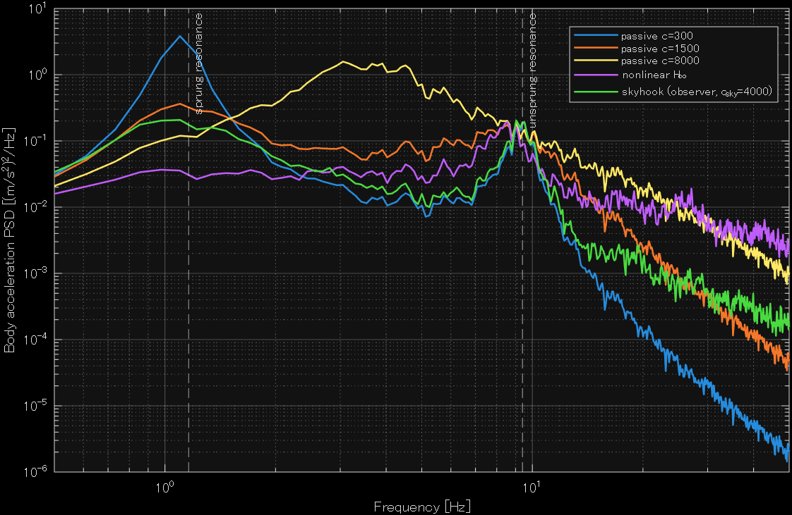

# Nonlinear H∞ Output-Feedback Control for Semi-Active Suspension of an In-Wheel-Motor Vehicle

Bachelor's thesis project, Chiba Institute of Technology (2022). MATLAB/Simulink.
*Revised in 2026: fixed model wiring, added the damper saturation constraint
(300–8000 Ns/m), input scaling, and a fair comparison with an observer-based skyhook controller.*

## Overview
In-wheel-motor (IWM) vehicles place the motor inside the wheel, which increases unsprung mass and degrades ride comfort and road holding. This project designs a nonlinear H∞ output-feedback controller for a semi-active suspension to suppress vertical vibration in a quarter-car model.

## Why a bilinear system
A semi-active damper can only change its damping coefficient. The damper force is the product of the control input (the damping coefficient) and a state (the relative velocity), so the system is bilinear, not linear. I applied the nonlinear H∞ control theory for bilinear systems proposed by Etsuro Shimizu from Tokyo University of Marine Science and Technology (1999).

## Method
- **Model:** 2-DOF quarter-car with in-wheel motor (sprung mass 300 kg, unsprung mass 50 kg incl. IWM,
  tire stiffness 160 kN/m, suspension stiffness 16 kN/m). Sprung/unsprung resonances ≈ 1.16 / 9.4 Hz.
- **Generalized plant:** frequency weights on body acceleration, suspension stroke, and body velocity
  (low-passed at 1 Hz), plus input weights → 16 states.
- **Controller:** nonlinear H∞ output feedback for bilinear systems (Shimizu, Ch. 5, Type 1),
  observer gain from an LMI (Lemma 5.3, γ1 = 1.5), controller from a Riccati equation (Lemma 5.4,
  γ2 = 1.05·γ2,min). The extra nonlinear weight m1(x̂) is set to 0 in this version.
- **Observer:** estimates all states from suspension stroke, body acceleration, and stroke velocity.
- **Input constraint:** damping coefficient limited to [300, 8000] Ns/m (saturation on the H∞ command).

*Revised in 2026: fixed model wiring, added the damper saturation constraint
(300–8000 Ns/m), input scaling, and a fair comparison with a skyhook controller.*

## Results
**Road input:** ISO 8608 Class C random road, 60 km/h, 80 s; the first 3 s are excluded.
Baselines: passive dampers and a continuous skyhook controller that uses the same
observer as the H∞ controller (no full-state information).

| Controller | RMS body acc. [m/s²] | RMS stroke [mm] | RMS tire defl. [mm] |
|---|---|---|---|
| Passive c=300 | 1.263 (+8.7%) | 22.17 (+123.9%) | 7.28 (+77.4%) |
| Passive c=1500 (baseline) | 1.162 | 9.90 | 4.10 |
| Passive c=8000 | 2.410 (+107.3%) | 4.22 (−57.4%) | 5.46 (+33.1%) |
| **Nonlinear H∞ (proposed)** | **0.977 (−15.9%)** | 11.32 (+14.3%) | 5.65 (+37.7%) |
| Skyhook continuous (observer, c_sky = 4000) | 0.819 (−29.5%) | 12.77 (+29.0%) | 7.03 (+71.4%) |

The H∞ controller gives the lowest body acceleration around the sprung-mass resonance
(below 2 Hz) and degrades stroke and tire deflection less than skyhook.
Above 2 Hz, including the 4–8 Hz band where humans are most sensitive,
skyhook performs better, so its overall RMS acceleration is lower.

## Limitations and future work
- The weighting functions are not tuned for ride comfort: the acceleration weight is
  nearly flat over 0.4–21 Hz, and the stroke and input weights have little influence.
  Next step: shape the acceleration weight toward the 4–8 Hz band (ISO 2631 Wk).
- The input-scaling loop (`cu`) did not fully converge in 3 iterations, so the H∞
  controller may be weaker than intended.
- `c_sky` for skyhook is not optimized; the nonlinear weight m1(x̂) is set to 0.
- Quarter-car model only, simulation only.

## Requirements
MATLAB/Simulink [R2026], Control System Toolbox, Signal Processing Toolbox,
YALMIP, SeDuMi.

## How to run
Run `scripts/run_hinf_suspension.m`. Figures and the results table are written to `results/`.
## Reference
E. Shimizu, [title of the 1999 thesis], 1999.
